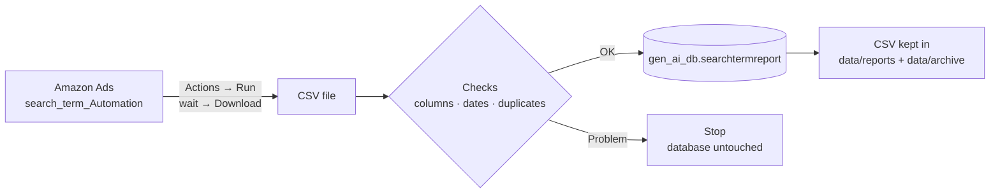

# Amazon Ads Search Term Automation


Downloads the **`search_term_Automation`** report from the Amazon Ads console every hour and stores it in the MySQL table **`gen_ai_db.searchtermreport`**. No one has to click *Download* or upload a CSV by hand.

---

## Contents

1. [At a glance](#at-a-glance)
2. [How it works](#how-it-works)
3. [Getting started](#getting-started)
4. [Everyday use](#everyday-use)
5. [Hourly schedule](#hourly-schedule)
6. [How data is saved (load modes)](#how-data-is-saved-load-modes)
7. [Checking that it works](#checking-that-it-works)
8. [Troubleshooting](#troubleshooting)
9. [Configuration](#configuration)
10. [The table](#the-table)
11. [Security](#security)
12. [Reference](#reference)

---

## At a glance

| | |
| --- | --- |
| **Source** | Amazon Ads console → Reporting → saved report `search_term_Automation` (period: **Today**) |
| **Destination** | MySQL `gen_ai_db.searchtermreport` |
| **Schedule** | Every hour at **:45 IST** |
| **How rows are saved** | **Upsert**: new rows are added, existing rows get the latest numbers, nothing is duplicated |
| **Run time** | A few minutes for a *Today* report; about 40 minutes for a full week (≈1.35 million rows) |
| **Safety** | Every file is checked before anything is written. If a check fails, the database is not touched. |

Each row is one **date × hour × marketplace × campaign × ad group × target × search term**, with all 32 report columns (impressions, clicks, cost, purchases, sales, units, CPC, CTR …).

---

## How it works



Every run goes through five steps:

1. **Check the database.** Confirms MySQL is reachable and the table has the expected columns, before opening Amazon.
2. **Get the report.** Opens `search_term_Automation` with the saved sign-in, clicks **Actions → Run**, waits until the new run shows **Download**, then downloads the CSV. With `--latest` it skips *Run* and downloads the newest finished run, like **Download latest** in Amazon.
3. **Check the file.** All 32 columns are present, dates are recent (no older than 8 days), and no row appears twice.
4. **Save to MySQL.** Rows are upserted in batches. See [load modes](#how-data-is-saved-load-modes).
5. **Keep the file.** The latest CSV is saved as `data/reports/amazon_ad_search_term_automation_today.csv`, with a timestamped copy in `data/archive/`.

> **Why dates can differ by marketplace:** each Amazon account reports in its own timezone. At the same moment a file can hold *Nov 6* for GB/DE/IT and *Nov 5* for the US. That's normal, and every row keeps its own date.

---

## Getting started

### What you need

- Windows 10/11, or a Linux server, with **Python 3.11+** and [**uv**](https://docs.astral.sh/uv/)
- Network access to the MySQL server and to Amazon Ads
- An Amazon Ads login that can open the `search_term_Automation` report

### Step 1 — Install

```bash
uv sync                                   # creates .venv with everything needed
uv run playwright install chromium        # installs the browser (Linux: add --with-deps)
```

### Step 2 — Configure

Copy the template and fill in your values:

```bash
cp .env.example .env
```

The values you must set:

| Setting | Where to find it |
| --- | --- |
| `DB_HOST`, `DB_USER`, `DB_PASSWORD` | From your database administrator |
| `REPORT_ID_TODAY` | In Amazon Ads → Reporting, open **search_term_Automation**. Copy the value after `reportId=` from the address bar, e.g. `c9595b04-2b65-44cd-8296-6c06ba2c2d26` |
| `AMAZON_EMAIL`, `AMAZON_PASSWORD` | The Amazon Ads login |

> **Important:** in Amazon, open the report's **Report settings** and set **Date range** to **Today**. The hourly job is built for the day-so-far report. A *Last week* report is about 1.35 million rows and is refused by the hourly job because of its old dates.

### Step 3 — Create the table (once)

```bash
uv run python run.py --create-table
```

This creates `gen_ai_db.searchtermreport` from [`sql/create_searchtermreport.sql`](sql/create_searchtermreport.sql). If your login can't create tables, ask an admin to run that SQL file instead.

### Step 4 — Sign in to Amazon (once)

```bash
uv run python run.py --login
```

1. A Chrome window opens and fills in the email and password.
2. Enter the **verification code (OTP)** Amazon sends you.
3. When the report page appears, the sign-in is saved. The window closes by itself, and closing it yourself is fine too.
4. The job then checks the saved sign-in in the background and prints **`OK: the saved session works`**.

You only need to repeat this if Amazon logs the session out (see [Troubleshooting](#troubleshooting)).

> On a Linux server without a screen, the same command asks for the OTP in the terminal.

### Step 5 — Test without saving anything

```bash
uv run python run.py --check-config      # settings only
uv run python run.py --inspect-page      # finds the buttons on the Amazon page, clicks nothing
uv run python run.py --load --dry-run    # full run, but nothing is written to MySQL
```

The last command should end with `status : SUCCESS`.

### Step 6 — Turn on the hourly schedule

See [Hourly schedule](#hourly-schedule).

---

## Everyday use

| I want to… | Command | Writes to MySQL? |
| --- | --- | --- |
| Run the job now | `uv run python run.py --load` | ✅ Yes |
| Store the newest finished run without clicking *Run* | `uv run python run.py --load --latest` | ✅ Yes |
| Test a full run safely | `uv run python run.py --load --dry-run` | ❌ No |
| Load a CSV I already have | `uv run python run.py --process-file "path\to\file.csv"` | ✅ Yes |
| Only download the CSV | `uv run python run.py --save-reports` | ❌ No |
| Sign in to Amazon again | `uv run python run.py --login` | ❌ No |
| Check the settings | `uv run python run.py --check-config` | ❌ No |
| Run the automated tests | `uv run python -m pytest` | ❌ No |

> **Loading an older file** (e.g. a *Last week* export): use `--process-file`. It accepts any dates. Add `--load-mode insert` so rows already in the table are left as they are.

---

## Hourly schedule

### On Windows (Task Scheduler)

```powershell
powershell -ExecutionPolicy Bypass -File scripts\install_task_windows.ps1              # every hour at :45
powershell -ExecutionPolicy Bypass -File scripts\install_task_windows.ps1 -Minute 0    # every hour at :00
powershell -ExecutionPolicy Bypass -File scripts\install_task_windows.ps1 -Remove      # turn it off
```

This creates the task **Amazon Search Term Automation**, which runs [`scripts/run_search_term_automation.ps1`](scripts/run_search_term_automation.ps1) every hour.

- To see it, open the **Task Scheduler** app and find the task in *Task Scheduler Library*. It shows the last result and the next run time.
- If a run is still going when the next hour starts, the new run is skipped.
- The PC must be **on** and you must be **signed in to Windows**. A run missed while the PC was off starts as soon as it's back on.

> ⚠️ **Known issue (6 Nov 2026):** the first scheduled run stalled while starting the browser, a problem that doesn't happen when the job is run from a terminal. It's being investigated. Until it's fixed, check `logs\search_term_cron.log` after a scheduled run, or run `uv run python run.py --load` by hand.

### On a Linux server (cron)

```bash
scripts/install_cron.sh --print    # checks the server and shows the cron entry
scripts/install_cron.sh            # installs it
crontab -l                         # confirm
```

The installer converts **:45 IST** to the server's clock (for example `15 * * * *` on a UTC server). It only adds or replaces its own entry; other cron jobs are not touched.

---

## How data is saved (load modes)

Choose with `DB_LOAD_MODE` in `.env`, or `--load-mode` for a single run.

| Mode | New rows | Rows already in the table | Rows no longer in the report | Best for |
| --- | --- | --- | --- | --- |
| **`upsert`** *(recommended)* | added | **updated** with the latest numbers | kept | the hourly *Today* report |
| `insert` | added | **left unchanged** | kept | loading old files (backfills) |
| `replace` | added | deleted and added again | **deleted** (for the file's dates and marketplaces) | full refreshes |

**How "the same row" is recognised.** A row matches an existing row when its date, hour, marketplace, campaign, ad group, target and search term are all the same. These values are combined into a fingerprint stored in the `row_key` column, which must be unique. The fingerprint also handles rows with no target ID (Sponsored Brands) and treats search terms that differ only in upper/lower case as separate rows.

**Large files.** `upsert` and `insert` save every 50,000 rows (`DB_COMMIT_EVERY_ROWS`). If the connection drops, run the same command again: rows already saved are kept, and `insert` continues where it stopped. `replace` always saves the whole file in one go, or nothing.

**Speed.** Rows are sent in batches of `DB_INSERT_CHUNK_SIZE` (10,000 recommended). A full week (≈1.35 million rows) takes about 40 minutes. A *Today* report takes a minute or two.

---

## Checking that it works

### Logs

| File | What's in it |
| --- | --- |
| `logs/search_term_cron.log` | One **START** and one **END** line per scheduled run, with the result |
| `logs/search_term_automation.log` | Full details of every run |
| `logs/search_term_cron_last_run.log` | Console output of the last scheduled run (Windows) |
| `data/screenshots/` | A screenshot of any browser step that failed |

A good run ends like this:

```text
Load (upsert): Today -> gen_ai_db.searchtermreport
Prepared 1412 row(s): 2026-11-06 [DE, GB, IT, US]
Committed searchtermreport: upsert: 432 inserted, 980 updated (...)
  status             : SUCCESS
```

### In the database

```sql
-- Rows and totals per day and marketplace (newest first)
SELECT report_date, campaign_country,
       COUNT(*) AS rows_, SUM(clicks) AS clicks, SUM(total_cost) AS cost, SUM(sales) AS sales,
       MAX(loaded_at) AS last_load_utc
FROM gen_ai_db.searchtermreport
GROUP BY report_date, campaign_country
ORDER BY report_date DESC, campaign_country
LIMIT 20;

-- Top search terms by cost today
SELECT search_term, SUM(clicks) AS clicks, SUM(total_cost) AS cost, SUM(sales) AS sales
FROM gen_ai_db.searchtermreport
WHERE report_date = CURDATE()
GROUP BY search_term
ORDER BY cost DESC
LIMIT 20;
```

With the hourly schedule on, `last_load_utc` should be less than an hour old.

---

## Troubleshooting

| You see | What it means | What to do |
| --- | --- | --- |
| `AuthenticationError` or `still showing the sign-in page` | Amazon logged the session out | Run `uv run python run.py --login` and enter the OTP |
| `Your password is incorrect` | The password in `.env` is out of date | Update `AMAZON_PASSWORD`, then run `--login` |
| `contains date(s) … outside …` | The report period isn't **Today** | Set **Date range → Today** in Amazon, or use `--latest` / `--process-file` for older data |
| `Table 'searchtermreport' does not exist` | The table hasn't been created | `uv run python run.py --create-table` |
| `Access denied` / `command denied` | The MySQL login is missing a permission | Ask an admin to run [`sql/grant_access.sql`](sql/grant_access.sql) |
| `Lost connection to MySQL server` | The network dropped during a long upload | Run the same command again. With `upsert`/`insert`, saved rows are kept. |
| `is missing column(s)` | A column was removed from the report in Amazon | Add it back under the report's **Report settings** |
| `report has no rows yet` | The day has only just started | Nothing to do; the next runs fill it in |
| `SKIPPED` / exit code 11 | The previous run was still going | Nothing to do, unless it happens every hour |

---

## Configuration

All settings live in `.env`. [`.env.example`](.env.example) explains every option. The most important ones:

| Setting | Default | What it does |
| --- | --- | --- |
| `REPORT_ID_TODAY` | — | The report to run (from `reportId=` in the URL) |
| `DB_LOAD_MODE` | `replace` (template: `upsert`) | How rows are saved: `upsert`, `insert` or `replace` |
| `DB_INSERT_CHUNK_SIZE` | `2000` | Rows sent per database statement (10,000 recommended) |
| `DB_COMMIT_EVERY_ROWS` | `50000` | Rows saved per batch for `upsert`/`insert` (`0` = whole file at once) |
| `DOWNLOAD_LATEST` | `false` | `true` = always take the newest finished run instead of clicking *Run* |
| `MAX_REPORT_AGE_DAYS` | `8` | Refuse files with rows older than this (not applied to `--latest` / `--process-file`) |
| `REPORT_ID_YESTERDAY` | — | Optional copy of the report with period *Yesterday*, run in the first hours of the day to complete it |
| `BROWSER_USER_AGENT` | — | Keeps the browser identity the same for sign-in and scheduled runs, so Amazon doesn't ask for the OTP again |
| `AMAZON_ACCOUNT_TIMEZONE` | `America/Los_Angeles` | The calendar used to decide what "today" is |
| `REPORT_READY_TIMEOUT_SECONDS` | `900` | How long to wait for Amazon to finish a report |
| `MAX_RETRIES` | `2` | Attempts for steps that can fail temporarily (download, connection) |

---

## The table

`gen_ai_db.searchtermreport`, defined in [`sql/create_searchtermreport.sql`](sql/create_searchtermreport.sql).

| Column(s) | From the report | Notes |
| --- | --- | --- |
| `report_date`, `hour` | Date, Hour | Each account's own timezone; hour 0–23 |
| `campaign_country` | Campaign country | Marketplace: US, CA, MX, GB, DE, FR, IT |
| `campaign_id`, `campaign_name`, `campaign_budget_amount`, `campaign_delivery_status`, `budget_currency` | Campaign … | |
| `ad_group_id`, `ad_group_name` | Ad group … | |
| `portfolio_id`, `portfolio_name` | Portfolio … | `-1` = no portfolio |
| `target_id`, `target_bid`, `target_type`, `target_status`, `targeting`, `targeting_match_type` | Target … / Targeting … | `target_id` is empty for some Sponsored Brands rows |
| `search_term` | Search term | `(Other)` is Amazon's group for low-volume terms |
| `impressions`, `clicks`, `purchases`, `units_sold` | same | Whole numbers |
| `total_cost`, `sales`, `*_multi_touch` | same | Decimals |
| `cpc`, `ctr` | CPC, CTR | `ctr` is a percentage (`2.5` = 2.5%) |
| `country`, `country_code` | Country, Country code | Currently always empty in Amazon's export |
| `report_id`, `loaded_at` | — | Which saved report the row came from, and when it was loaded (UTC) |
| `row_key` | — | The row's unique fingerprint (used by upsert/insert) |

**Read-only access** for Power BI or analysts: see the commented `GRANT SELECT` line in [`sql/grant_access.sql`](sql/grant_access.sql).

---

## Security

- **`.env`** holds the database and Amazon passwords. Never commit it or share it (it's already in `.gitignore`). On Linux, restrict it with `chmod 600 .env`.
- **`data/session/`** and **`data/session_state.json`** hold the signed-in Amazon session. Treat them like a password, and don't copy them to other projects.
- The database login only needs `SELECT`, `INSERT`, `UPDATE` and `DELETE` on this one table. See [`sql/grant_access.sql`](sql/grant_access.sql).
- Logs never contain passwords, and web addresses in logs have their tokens removed.

---

## Reference

<details>
<summary><b>Exit codes</b></summary>

| Code | Meaning |
| --- | --- |
| 0 | Success |
| 2 | Configuration problem (a missing or wrong `.env` value) |
| 3 | Amazon sign-in needed: run `--login` |
| 4 / 6 | Page or download failed (after retries) |
| 7 | The file is not a valid Search term CSV |
| 8 | Data problem (bad IDs, numbers, dates or duplicate rows) |
| 9 | Database problem |
| 11 | The previous run is still in progress (skipped) |
| 12 | Report ID is not valid or not found |
| 13 | Amazon didn't finish the report in time |
| 14 | The report's dates are outside the allowed window |
| 16 | Not every report was loaded (the log shows why) |

</details>

<details>
<summary><b>All command options</b></summary>

| Option | What it does |
| --- | --- |
| `--load` | Run the report, download it and save it to MySQL (the default) |
| `--latest` | Download the newest finished run instead of clicking *Run* |
| `--load-mode upsert\|insert\|replace` | Override `DB_LOAD_MODE` for this run |
| `--dry-run` | Do everything except write to MySQL |
| `--process-file PATH` | Load a CSV that's already on disk (any dates) |
| `--save-reports` | Download only, no database |
| `--create-table` | Create the table if it doesn't exist |
| `--login` | Sign in to Amazon and save the session |
| `--check-config` | Validate `.env` only |
| `--inspect-page [--inspect-menu]` | Check the buttons on the Amazon page, clicking nothing |
| `--report-id UUID` | Use another report for `--login` / `--inspect-page`, or record it with `--process-file` |
| `--headed` | Show the browser window |
| `--env-file PATH` | Use another settings file |
| `--no-lock` | Skip the single-run lock (supervised use only) |
| `--log-level`, `--echo-sql` | More detail in the logs |

</details>

<details>
<summary><b>Project structure</b></summary>

```text
run.py                               entry point for every command
app/
  main.py                            the run: steps, modes, summary
  report_history.py                  Amazon report page: Run, wait, Download
  browser.py, auth.py                Chrome session and Amazon sign-in
  search_term_processor.py           reads and checks the CSV
  database.py                        MySQL checks and the upsert / insert / replace writers
  report_saver.py                    which report runs when, saved file names
  config.py                          reads .env
config/selectors.json                how the job finds buttons on Amazon's pages
sql/
  create_searchtermreport.sql        the table
  grant_access.sql                   the MySQL login and permissions
  migrate_add_row_key.sql            one-time upgrade for a table created before row_key existed
scripts/
  install_task_windows.ps1           Windows: create / remove the hourly task
  run_search_term_automation.ps1     Windows: what the hourly task runs
  install_cron.sh                    Linux: install the hourly cron entry
  run_search_term_automation.sh      Linux: what cron runs
data/
  reports/                           latest amazon_ad_search_term_automation_today.csv
  archive/                           timestamped copy of every loaded file
  failed/                            files that failed the checks
  session/, session_state.json       saved Amazon sign-in (treat as a password)
  screenshots/                       screenshots of failed browser steps
logs/                                run logs
tests/                               automated tests (no Amazon or MySQL needed)
```

</details>

<details>
<summary><b>Testing</b></summary>

| What | Command | Writes to MySQL? |
| --- | --- | --- |
| Automated tests | `uv run python -m pytest` | No (uses an in-memory database) |
| Settings | `uv run python run.py --check-config` | No |
| Amazon page buttons | `uv run python run.py --inspect-page --inspect-menu` | No |
| A CSV against the live table | `uv run python run.py --process-file file.csv --dry-run` | No |
| Full hourly job | `uv run python run.py --load --dry-run` | No |

</details>
