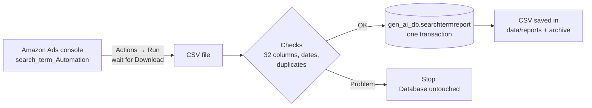

# Search Term Automation → Gen AI DB


Every hour, this job opens the saved **`search_term_Automation`** report in the Amazon Ads console, runs it, downloads the CSV and loads it into **`gen_ai_db.searchtermreport`**. Nobody needs to click **Download** or upload a CSV.

It is built the same way as `Amazon_ad_targeting_report_cron` (same browser, sign-in, retry, lock and logging code), but has its own settings, Amazon session and data.

---

## Contents

- [At a glance](#at-a-glance)
- [How it works](#how-it-works)
- [When it runs](#when-it-runs)
- [Setup on a Linux server](#setup-on-a-linux-server)
- [Everyday commands](#everyday-commands)
- [Checking that it works](#checking-that-it-works)
- [Troubleshooting](#troubleshooting)
- [Load modes](#load-modes)
- [Configuration](#configuration)
- [The table](#the-table)
- [Reference](#reference)

---

## At a glance

| | |
| --- | --- |
| **Source** | Amazon Ads console (advertising.amazon.de, All accounts) → Reporting → saved report `search_term_Automation` |
| **Destination** | MySQL `gen_ai_db`, new table `searchtermreport` |
| **Schedule** | Every hour at **:45 IST** (12:45 PM, 1:45 PM, 2:45 PM …), 15 minutes after the Targeting job |
| **Run time** | About 3–10 minutes per run |
| **Load mode** | `DB_LOAD_MODE` = `replace`, `upsert` or `insert`: see [Load modes](#load-modes) |
| **Safety** | Every load is **one transaction**. A failed run changes nothing. |

One row per **date × hour × marketplace × campaign × ad group × target × search term**, with all 32 columns from the report (impressions, clicks, cost, purchases, sales, units, CPC, CTR …).

---

## How it works



Each run:

1. **Checks first.** Confirms MySQL is reachable and the table has the expected columns before opening Amazon.
2. **Runs the report in Amazon.** Opens `search_term_Automation` (the page in the second screenshot: *Report history*), clicks **Actions → Run**, reloads until the new row's status turns into **Download**, then downloads the CSV. If a run is already *Processing*, it waits for that one instead of starting another.
3. **Validates the file.** All 32 columns are present, every row has a recent date (not older than `MAX_REPORT_AGE_DAYS`), and no row appears twice.
4. **Saves to MySQL** in **one transaction**, according to `DB_LOAD_MODE` (see [Load modes](#load-modes)):
   - `replace`: for each **date + marketplace** in the file (e.g. `2026-11-06 GB`, `2026-11-06 US`), deletes the existing rows and inserts the new ones. Other dates and marketplaces are never touched.
   - `upsert`: inserts rows that are new and updates rows that are already in the table.
   - `insert`: inserts rows that are new and leaves rows already in the table unchanged.
5. **Keeps the file.** The latest CSV goes to `data/reports/amazon_ad_search_term_automation_today.csv`, and a timestamped copy goes to `data/archive/`.

---

## When it runs

The report covers every marketplace (US, CA, MX, GB, DE, FR, IT), and each account reports in its **own** timezone. So one file can hold, for example, **Nov 6** for GB/DE/IT (their day has started) and **Nov 5** for the US (still the previous day in Los Angeles).

That's why the job replaces data per **date + marketplace**: each hourly run overwrites "the day so far" for each account with the latest numbers, and never deletes a day that isn't in the file.

| Run time (IST) | What's loaded |
| --- | --- |
| Every hour at **:45** | `search_term_Automation` with report period **Today**: the day so far for every marketplace |
| **12:45 PM** and **1:45 PM** (optional) | also the **Yesterday** report, if `REPORT_ID_YESTERDAY` is set: completes the day that just ended (its last hour and late sales) |

> **Set the report period to "Today".** In Amazon Ads → `search_term_Automation` → **Report settings**, choose **Today**. Its last run used **Last week**, which is ~1.35 million rows (425 MB) and too large to reload every hour. The job refuses files with rows older than 8 days (`MAX_REPORT_AGE_DAYS`).
>
> **Optional Yesterday report.** For complete final numbers, make a copy of the report with period **Yesterday** and put its ID in `REPORT_ID_YESTERDAY`. It only runs in the first two hours of the Los Angeles day, when every marketplace's previous day has ended.

---

## Setup on a Linux server

**You need:** Linux with Python 3.11+, network access to MySQL (`gen_ai_db`) and Amazon, and an Amazon Ads login with access to the accounts.

### 1. Copy and install

```bash
cd ~/Amazon_ad_search_term_automation_cron
curl -LsSf https://astral.sh/uv/install.sh | sh     # install uv (once per server)
uv sync --no-dev                                    # create .venv from uv.lock
uv run playwright install --with-deps chromium      # install the browser
chmod +x scripts/*.sh
```

> Copy the project **without** `.venv/` and `data/session/`. Both are created on the server.

### 2. Get database access

A MySQL admin runs [`sql/grant_access.sql`](sql/grant_access.sql) (after changing the password). It creates a login that can only `SELECT`, `INSERT`, `UPDATE` and `DELETE` in `gen_ai_db.searchtermreport` (`UPDATE` is used by the upsert and insert load modes).

### 3. Configure

```bash
cp .env.example .env && chmod 600 .env     # then fill in the values
```

Fill in at least the database login, `REPORT_ID_TODAY` and the Amazon login. See [Configuration](#configuration).

**Where to find `REPORT_ID_TODAY`:** in Amazon Ads → Reporting, click **search_term_Automation**. The address bar shows `…/reporting/history?…reportId=xxxxxxxx-xxxx-xxxx-xxxx-xxxxxxxxxxxx`. Copy that value.

> Running as **root**? Add `BROWSER_NO_SANDBOX=true` to `.env`.

### 4. Create the table (once)

```bash
uv run python run.py --create-table
```

This runs [`sql/create_searchtermreport.sql`](sql/create_searchtermreport.sql) (`CREATE TABLE IF NOT EXISTS`) and checks the result. It needs `CREATE` permission; if the loader login doesn't have it, an admin can run that SQL file instead.

### 5. Sign in to Amazon once

```bash
uv run python run.py --login
```

**On a computer with a screen (Windows, macOS, Linux desktop)** a Chrome window opens and fills in the email and password. Enter the **verification code (OTP)** in that window. The session is saved as soon as the report page shows, and closing the window at any point is fine. The job then reopens the report in the hidden browser the scheduled runs use, and prints `OK: the saved session works` if it can.

**On a server without a screen** it signs in hidden and asks for the OTP in the terminal.

The session is kept in the Chrome profile `data/session/`, with a backup of its cookies in `data/session_state.json` (restored automatically if the profile loses them). Both are credentials. Keep `BROWSER_USER_AGENT` set to the window's identity (see `.env.example`), so Amazon sees the same browser in the window and in the scheduled runs and doesn't ask for the OTP again.

### 6. Test without writing to the database

```bash
uv run python run.py --check-config
uv run python run.py --inspect-page          # finds the Actions / Download controls, clicks nothing
uv run python run.py --load --dry-run
```

The last command does a full run (Amazon run + download, checks) but **writes nothing**. It should end with `status : SUCCESS`.

### 7. Turn on the hourly schedule

```bash
scripts/install_cron.sh --print   # checks the server and shows the cron entry
scripts/install_cron.sh           # installs it
crontab -l                        # confirm
```

The installer converts **:45 IST** into your server's clock:

| Server timezone | Installed entry | Runs at |
| --- | --- | --- |
| UTC (most cloud servers) | `15 * * * * …` | :45 IST |
| Asia/Kolkata | `45 * * * * …` | :45 IST |

It only adds or replaces its own entry, so other cron jobs (like the Targeting job) aren't touched. If a run is still going when the next hour starts, the new run is skipped instead of overlapping.

#### On Windows (Task Scheduler instead of cron)

```powershell
powershell -ExecutionPolicy Bypass -File scripts\install_task_windows.ps1             # every hour at :45
powershell -ExecutionPolicy Bypass -File scripts\install_task_windows.ps1 -Minute 15  # another minute
powershell -ExecutionPolicy Bypass -File scripts\install_task_windows.ps1 -Remove     # stop it
```

This registers the task **Amazon Search Term Automation**. It runs [`scripts/run_search_term_automation.ps1`](scripts/run_search_term_automation.ps1) `--load` every hour while you're signed in to Windows. If the previous run is still going, the new one doesn't start. Each run writes one START / END line to `logs/search_term_cron.log`, and the last run's console output goes to `logs/search_term_cron_last_run.log`. You can also see the task, its last result and next run time in **Task Scheduler** (search for it in the Start menu).

The PC must be on and you must be signed in to Windows at the scheduled time. A run missed while the PC was off starts as soon as it's back.

---

## Everyday commands

| I want to… | Command | Writes to MySQL? |
| --- | --- | --- |
| Run the hourly job now | `uv run python run.py --load` | ✅ yes |
| Run it once with another load mode | `uv run python run.py --load --load-mode upsert` (or `insert`, `replace`) | ✅ yes |
| Run it as a test | `uv run python run.py --load --dry-run` | ❌ no |
| Load a CSV I already have (e.g. last week's) | `uv run python run.py --process-file path/to/search_term_Automation.csv` | ✅ yes |
| Only download the CSV | `uv run python run.py --save-reports` | ❌ no |
| Create the table | `uv run python run.py --create-table` | ✅ yes (once) |
| Sign in to Amazon again | `uv run python run.py --login` | ❌ no |
| Check the settings | `uv run python run.py --check-config` | ❌ no |
| Run the automated tests | `uv run python -m pytest` | ❌ no |

> On a Linux server with a display attached, add `--headed` to `--login` to get the visible window.
>
> `--process-file` accepts any period (e.g. a "Last week" export for a backfill). Large files are slow: 1.35 million rows take several minutes.

---

## Checking that it works

### Logs

```bash
tail -f logs/search_term_cron.log                                    # one START / END line per run
grep -E "Load:|Committed|covers|status" logs/search_term_automation.log | tail
```

A good run looks like this:

```text
# logs/search_term_cron.log
2026-11-06T09:15:01Z (14:45 IST) START search term automation (pid 4182)
2026-11-06T09:19:40Z (14:49 IST) END status=0 SUCCESS

# logs/search_term_automation.log
Load (upsert): Today -> gen_ai_db.searchtermreport
Prepared 1412 row(s): 2026-11-06 [DE, GB, IT, US]
Committed searchtermreport: upsert: 432 inserted, 980 updated (2026-11-06/DE, 2026-11-06/GB, 2026-11-06/IT, 2026-11-06/US)
  status             : SUCCESS
```

With `DB_LOAD_MODE=replace` the line reads `replace: 980 deleted, 1412 inserted`, and with `insert` it reads `insert: 432 inserted, 980 already present (unchanged)`.

### Database

```sql
-- Rows and totals per day and marketplace
SELECT report_date, campaign_country, COUNT(*) AS rows_, SUM(clicks) AS clicks, SUM(total_cost) AS cost,
       SUM(sales) AS sales, MAX(loaded_at) AS last_load_utc
FROM gen_ai_db.searchtermreport
GROUP BY report_date, campaign_country
ORDER BY report_date DESC, campaign_country
LIMIT 20;

-- Top search terms today
SELECT search_term, SUM(clicks) clicks, SUM(total_cost) cost, SUM(sales) sales
FROM gen_ai_db.searchtermreport
WHERE report_date = CURDATE()
GROUP BY search_term ORDER BY cost DESC LIMIT 20;
```

`last_load_utc` should be less than an hour old.

---

## Troubleshooting

| You see | What it means | What to do |
| --- | --- | --- |
| `AuthenticationError` / `still showing the sign-in page` | The Amazon session expired and Amazon wants a verification code. | Run `uv run python run.py --login`, enter the code. |
| `Your password is incorrect` (screenshot in `data/screenshots/`) | `AMAZON_PASSWORD` in `.env` is out of date. | Update it, then run `--login`. |
| `Table 'searchtermreport' does not exist` | The table hasn't been created yet. | `uv run python run.py --create-table` (or an admin runs the SQL file). |
| `Access denied` / `command denied` | The MySQL login lacks a permission. | An admin runs `sql/grant_access.sql`. |
| `contains date(s) … outside …` | The report period isn't **Today** (or the file is old). | Nothing was saved. Set the period to Today in Amazon, or raise `MAX_REPORT_AGE_DAYS`. |
| `is missing column(s)` | A column was removed from the saved report in Amazon. | Add it back in the report's settings. |
| `row(s) repeat the same date/hour/…` | The file has duplicate rows. | Nothing was saved. Check the report in Amazon. |
| `report has no rows yet; existing rows kept` | The day has only just started. | Nothing. The next runs fill it in. |
| `SKIPPED` / exit code 11 | The previous run was still going. | Nothing, unless it happens every hour. |

Screenshots of any failed browser step are saved in `data/screenshots/`.

---

## Load modes

`DB_LOAD_MODE` in `.env` controls how the downloaded rows are written. `--load-mode` overrides it for one run. Each mode is **one transaction**, so a failed run changes nothing.

| Mode | New rows | Rows already in the table | Rows missing from the new file |
| --- | --- | --- | --- |
| `replace` | inserted | deleted and inserted again | **deleted** (for the file's dates + marketplaces) |
| `upsert` | inserted | **updated** with the new numbers | kept |
| `insert` | inserted | **left unchanged** | kept |

A row is "already in the table" when it has the same **date, hour, marketplace, campaign, ad group, target and search term**. The `row_key` column holds a SHA-256 of those values and has a UNIQUE index. A hash is used instead of a plain UNIQUE index because Sponsored Brands rows have no target ID (MySQL's UNIQUE never matches NULLs), and because the table's collation would treat `Shoes` and `shoes` as the same row.

- **`upsert`** suits the hourly Today report: each run adds the new hours and updates the hours already loaded.
- **`insert`** suits backfills where existing data must not change, e.g. `run.py --process-file old.csv --load-mode insert`.
- **`replace`** also removes rows that Amazon dropped from a later version of the report. Upsert and insert never delete.

**Switching an existing table to `upsert` / `insert`.** A table created before `row_key` existed needs a one-time migration. An admin runs [`sql/migrate_add_row_key.sql`](sql/migrate_add_row_key.sql) (pause the cron job first). Until then, upsert and insert stop with a message pointing to that file, and `replace` keeps working without the column. A table created with the current `--create-table` already has `row_key`.

---

## Configuration

All settings live in `.env` (copy `.env.example`, which explains every option). The important ones:

| Setting | What it is |
| --- | --- |
| `DB_HOST`, `DB_PORT`, `DB_USER`, `DB_PASSWORD` | MySQL login. `DB_NAME` must be `gen_ai_db`. |
| `REPORT_ID_TODAY` | The `reportId=…` of `search_term_Automation` (period **Today**). |
| `REPORT_ID_YESTERDAY` | Optional: a copy of the report with period **Yesterday**. |
| `AMAZON_ENTITY_ID` | Leave unset: the report is under **All accounts**. Set only for a single-account report. |
| `AMAZON_EMAIL`, `AMAZON_PASSWORD` | Used to sign in again when the session expires. |
| `AMAZON_ACCOUNT_TIMEZONE` | Browser timezone and "today" (default `America/Los_Angeles`, the westernmost marketplace). |
| `MAX_REPORT_AGE_DAYS` | Refuse files with rows older than this (default `8`). |
| `DB_LOAD_MODE` | `replace` (default when unset), `upsert` or `insert`. See [Load modes](#load-modes). |
| `BROWSER_USER_AGENT` | Keeps the browser identity stable so the Amazon session lasts. Use the Linux value from `.env.example` on the server. |
| `REPORT_READY_TIMEOUT_SECONDS` | How long to wait for Amazon to finish a report (default 15 minutes). |

> 🔒 `.env` and `data/session/` contain credentials. Keep them out of git (already in `.gitignore`) and readable only by the job's user (`chmod 600 .env`). Don't reuse the Targeting job's `data/session/`.

---

## The table

`gen_ai_db.searchtermreport`, defined in [`sql/create_searchtermreport.sql`](sql/create_searchtermreport.sql):

| Column | From report column | Notes |
| --- | --- | --- |
| `id` | – | auto-increment key |
| `report_date`, `hour` | Date, Hour | date in each account's own timezone; hour 0–23 |
| `campaign_country` | Campaign country | marketplace: US, CA, MX, GB, DE, FR, IT |
| `campaign_id`, `campaign_name`, `campaign_budget_amount`, `campaign_delivery_status`, `budget_currency` | Campaign … | IDs stored without Amazon's `="…"` wrapper |
| `ad_group_id`, `ad_group_name` | Ad group … | |
| `portfolio_id`, `portfolio_name` | Portfolio … | `-1` = No Portfolio |
| `target_id`, `target_bid`, `target_type`, `target_status`, `targeting`, `targeting_match_type` | Target …, Targeting … | `target_id` is empty for some Sponsored Brands rows |
| `search_term` | Search term | `(Other)` is Amazon's bucket for low-volume terms |
| `country`, `country_code` | Country, Country code | currently always empty in the export |
| `impressions`, `clicks`, `purchases`, `units_sold` | same | whole numbers |
| `total_cost`, `sales`, `*_multi_touch` | same | decimals |
| `cpc`, `ctr` | CPC, CTR | `ctr` is a percentage (`2.5` = 2.5%); empty when there were no clicks / impressions |
| `report_id`, `loaded_at` | – | which saved report and when (UTC) the row was loaded |

`row_key` (no report column) is the SHA-256 of date, hour, marketplace, campaign, ad group, target and search term. It is the match key for upsert and insert.

Indexes: UNIQUE `row_key` for upsert / insert, `(report_date, campaign_country)` for replace, `(campaign_id, report_date)`, and `search_term`.

Read-only access for Power BI or analysts: see the commented `GRANT SELECT` line in [`sql/grant_access.sql`](sql/grant_access.sql).

---

## Reference

<details>
<summary><b>Exit codes</b></summary>

| Code | Meaning |
| --- | --- |
| 0 | Success |
| 2 | Configuration problem (missing `.env` value) |
| 3 | Amazon sign-in needed: run `--login` |
| 4 / 6 | Page or download failed (after retries) |
| 7 | Not a valid Search term CSV |
| 8 | Data problem (bad IDs, numbers, dates, duplicates) |
| 9 | Database problem (rolled back, nothing changed) |
| 11 | Previous run still in progress (skipped) |
| 12 | Report ID not valid or not found |
| 13 | Amazon didn't finish the report in time |
| 14 | The report's dates are outside the allowed window |
| 16 | Not every report was loaded (the log shows why) |

</details>

<details>
<summary><b>Project structure</b></summary>

```text
run.py                         entry point for every command
app/
  main.py                      the run: steps, modes, run summary
  report_saver.py              which report runs when, file publishing
  report_history.py            Amazon report page: Run, wait, Download
  browser.py, auth.py          Chrome session and Amazon sign-in
  search_term_processor.py     reads and checks the Search term CSV
  database.py                  MySQL checks, CREATE TABLE and the single transaction
  config.py                    reads .env
config/
  selectors.json               how the job finds buttons on Amazon's pages
sql/
  create_searchtermreport.sql   the table
  grant_access.sql                    the MySQL login and permissions
scripts/
  install_cron.sh              checks the server and installs the hourly entry
  run_search_term_automation.sh   cron wrapper: lock, paths, exit status
data/
  reports/                     latest amazon_ad_search_term_automation_today.csv
  archive/                     timestamped copies of every loaded file
  failed/                      files that failed the checks
  session/                     saved Amazon sign-in (treat as a password)
  screenshots/                 screenshots of failed browser steps
logs/                          search_term_automation.log, search_term_cron.log
tests/                         automated tests (no Amazon, no MySQL needed)
```

</details>

<details>
<summary><b>Testing</b></summary>

| What | Command | Writes to MySQL? |
| --- | --- | --- |
| Automated tests | `uv run python -m pytest` | no (uses an in-memory database) |
| Settings | `uv run python run.py --check-config` | no |
| Amazon page buttons, read-only | `uv run python run.py --inspect-page --inspect-menu` | no |
| One CSV against the live table | `uv run python run.py --process-file search_term_Automation.csv --dry-run` | no |
| Full hourly job | `uv run python run.py --load --dry-run` | no |

</details>
# Amazon-ad-search-term-automation

